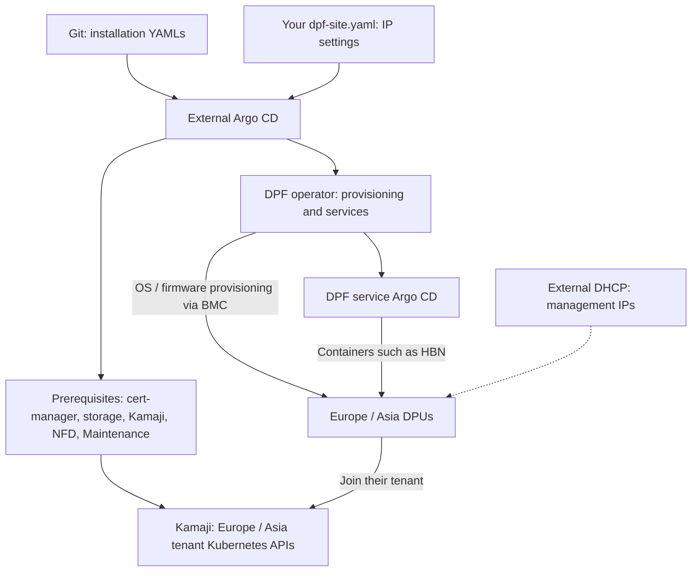

# Install DPF with Argo CD

**Edit [dpf-site.yaml](dpf-site.yaml).** It already contains our lab IPs.
For another environment, change the lines marked `# please change here`.
Passwords stay outside Git. No Git clone or push is needed to use your local
IP overrides.

This file configures DPF and the Europe/Asia tenants **after platform installation**.
It contains two Applications; sync them in order below. HBN and DPU provisioning
are later steps, covered by the [full walkthrough](STAGED-INSTALL.md).

## How it fits together



## Where DHCP is needed

For this lab, provide DHCP on the **DPU management/OOB and BMC network before
DPU provisioning**. Use MAC reservations so addresses stay predictable. The DPU
BMC address entered in its later inventory YAML must match its actual address.
A customer can use preconfigured static management/BMC addressing instead where
supported by their hardware and OS provisioning setup.

| Address | Our lab | Assignment |
| --- | --- | --- |
| Management Kubernetes API | `10.220.175.20:6443` | Existing stable endpoint |
| Europe / Asia tenant VIP | `192.168.0.200` / `192.168.0.203` | Manual YAML values; keep outside DHCP leases |
| Europe / Asia DPU management | `192.168.0.244` / `192.168.0.242` | DHCP reservations; separate from VIPs |
| Europe / Asia DPU BMC | `192.168.0.246` / `192.168.0.249` | DHCP reservations; later provisioning inputs |

Our DHCP service is **dnsmasq on `l-ae-1137d` (`192.168.0.1`)**, outside Kubernetes:
`nico-lab-dhcp`, configuration `/etc/nico-lab-dhcp.conf`.
**This Argo package does not install DHCP.** Reinstalling DPF does not replace it.
The current site file changes the API/VIPs, not DHCP reservations or DPU IPs.

## Step 1 — External Argo CD and DPF platform

Requires a working management Kubernetes cluster, Helm and kubectl.
**Our lab already has external Argo CD: skip its Helm install.**
On a new cluster, install it first:

```bash
helm repo add argo https://argoproj.github.io/argo-helm
helm repo update argo
helm install external-argo-cd argo/argo-cd \
  --version 9.4.1 \
  --namespace argocd --create-namespace \
  --set configs.cm.installationID=dsx-platform \
  --wait --timeout 10m
```

Install the prerequisites and DPF 26.4.0. Published defaults **enable Local Path
storage**, suitable for our cleaned lab. To reuse existing storage, follow the
[storage setting](STAGED-INSTALL.md#2-choose-storage) before applying.

```bash
kubectl apply -f https://raw.githubusercontent.com/kirson-git/dsx-os/main/DPF/generated/applications/00-platform.yaml
kubectl -n argocd patch application dpf-platform --type merge \
  -p '{"operation":{"sync":{"prune":false,"syncOptions":["ServerSideApply=true","ClientSideApplyMigration=false","FailOnSharedResource=true"],"syncStrategy":{"hook":{}}}}}'
kubectl -n argocd get application dpf-platform -w
```

Wait for `Synced` / `Healthy`, then press Ctrl+C. Before continuing, verify that
this command prints `Succeeded`:

```bash
kubectl -n argocd get application dpf-platform -o jsonpath='{.status.operationState.phase}{"\n"}'
```

## Step 2 — Edit your file and configure DPF

```bash
curl -fL \
  https://raw.githubusercontent.com/kirson-git/dsx-os/main/DPF/dpf-site.yaml \
  -o dpf-site.yaml
vi dpf-site.yaml
kubectl apply -f dpf-site.yaml
kubectl -n argocd patch application dpf-operator-config --type merge \
  -p '{"operation":{"sync":{"prune":false,"syncOptions":["ServerSideApply=true","ClientSideApplyMigration=false","FailOnSharedResource=true"],"syncStrategy":{"hook":{}}}}}'
kubectl -n argocd get application dpf-operator-config -w
```

Our lab values are ready to use; review them before applying. Wait for sync to
finish, press Ctrl+C, then verify `Succeeded` before step 3:

```bash
kubectl -n argocd get application dpf-operator-config -o jsonpath='{.status.operationState.phase}{"\n"}'
```

Do not overwrite an already customized local file with another download.
Do not reapply generic operator/tenant Applications afterward, as those would
replace your overrides.

## Step 3 — Create Europe and Asia

```bash
kubectl -n argocd patch application dpf-tenants --type merge \
  -p '{"operation":{"sync":{"prune":false,"syncOptions":["ServerSideApply=true","ClientSideApplyMigration=false","FailOnSharedResource=true"],"syncStrategy":{"hook":{}}}}}'
kubectl -n argocd get application dpf-tenants -w
```

After sync finishes, press Ctrl+C and check:

```bash
kubectl -n argocd get application dpf-tenants -o jsonpath='{.status.operationState.phase}{"\n"}'
kubectl get dpuclusters -A
```

Expect a successful operation and two Ready tenant clusters. DPUs join later;
this does not yet install HBN or reimage hardware.

**Next:** [HBN and DPU provisioning](STAGED-INSTALL.md#7-apply-hbn-networking).
Create the private BMC Secret with `DPF/credentials.sh` before that provisioning
stage. The [credential guide](CREDENTIALS.md) has the exact commands.

[All separate apply/sync steps](STAGED-INSTALL.md) ·
[Full-stack single Application](INSTALLATION-DETAILS.md#option-a-one-yaml-for-the-complete-stack) ·
[Production settings](PRODUCTION.md) · [Agent rules](../AGENTS.md)

The full-stack Application owns overlapping resources: use it only as a separate
installation option, not together with the staged Applications above.
