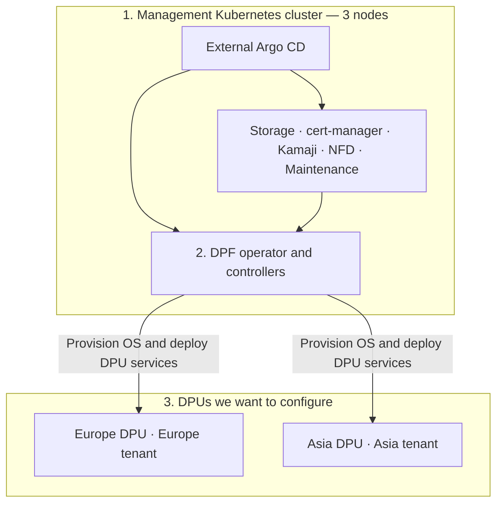

# Install DPF with Argo CD

**One file to edit: [config.yaml](config.yaml).** It contains the Kubernetes API,
tenant VIPs, optional DHCP and MAC reservations. Argo reads the templates from
Git. Passwords stay outside Git; the public file has blank MAC fields.

## How it fits together



The steps below install prerequisites, configure DPF and create both tenant APIs.
**HBN and hardware provisioning follow later.** Applying this configuration does
not reimage DPUs.

## Step 1 — External Argo CD and DPF platform

Requires a working management Kubernetes cluster, Helm and kubectl.
**Our lab already has external Argo CD: skip its Helm install.**
On a new cluster, install it first:

```bash
helm repo add argo https://argoproj.github.io/argo-helm
helm repo update argo
helm install external-argo-cd argo/argo-cd \
  --version 9.4.1 \
  --namespace argocd --create-namespace \
  --set configs.cm.installationID=dsx-platform \
  --wait --timeout 10m
```

Install the prerequisites and DPF 26.4.0. Published defaults **enable Local Path
storage**, suitable for our cleaned lab. To reuse existing storage, follow the
[storage setting](STAGED-INSTALL.md#2-choose-storage) before applying.

```bash
kubectl apply -f https://raw.githubusercontent.com/kirson-git/dsx-os/main/DPF/generated/applications/00-platform.yaml
kubectl -n argocd patch application dpf-platform --type merge \
  -p '{"operation":{"sync":{"prune":false,"syncOptions":["ServerSideApply=true","ClientSideApplyMigration=false","FailOnSharedResource=true"],"syncStrategy":{"hook":{}}}}}'
kubectl -n argocd get application dpf-platform -w
```

The sync waits for cert-manager’s API readiness check before creating dependent
certificates. Start sync once; do not launch another while it is `Running`.
Wait for `Synced` / `Healthy`, then press Ctrl+C. Before continuing, verify that
this command prints `Succeeded`:

```bash
kubectl -n argocd get application dpf-platform -o jsonpath='{.status.operationState.phase}{"\n"}'
```

## Step 2 — Edit your one configuration file

For a new customer, download the public template:

```bash
curl -fL \
  https://raw.githubusercontent.com/kirson-git/dsx-os/main/DPF/config.yaml \
  -o config.yaml
vi config.yaml
```

For our lab, the populated file is already on the administration server:

```bash
cd /tmp/dpf-lab
vi config.yaml
```

Use **one** of these paths; do not overwrite your populated file with a download.
Review the lines marked `# please change here`:

| Setting | What it means |
| --- | --- |
| `apiServerIP` | Existing management Kubernetes API; our lab uses `10.220.175.20:6443` |
| `vipInterface` | Management-node interface carrying tenant VIPs; lab `enp7s0` |
| `europeVIP` / `asiaVIP` | Reserved floating IPs `.200` / `.203`; never DHCP allocations |
| `install-dhcp` | Quoted `"no"` uses existing DHCP; quoted `"yes"` installs the DHCP pod |
| `dhcp.reservations` | Management MAC and reserved IP for each device; fill blanks before enabling DHCP |

**Keep `install-dhcp: "no"` for the first DPF test.** Our existing DHCP still
serves the lab. To move it into Kubernetes, follow the [DHCP cutover](DHCP.md).

## Step 3 — Apply and check

Run from the directory containing your edited `config.yaml`:

```bash
kubectl apply -f config.yaml
kubectl -n argocd get application dpf-site -w
```

Sync starts automatically: DPF configuration first, then Europe and Asia.
Press Ctrl+C to stop watching; installation continues. Check the result:

```bash
kubectl -n argocd get application dpf-site -o jsonpath='{.status.operationState.phase}{"\n"}{.status.operationState.message}{"\n"}'
kubectl get dpuclusters -A
```

Expect `Succeeded` and two `Ready` tenant clusters. DPUs join in the later
provisioning stage. If sync fails, read its message before retrying.

Do not combine `dpf-site` with the older `dpf-operator-config`, `dpf-tenants`, or
full-stack `dpf` Applications: they own the same resources. The separate
`dpf-platform` Application from Step 1 is required and compatible.

## Where DHCP is needed

DHCP supplies **DPU management/OOB IPs** before provisioning. Our lab also uses
reservations for BMCs, iDRACs and Asia's host management NIC. Tenant VIPs are manual.
`apiServerIP` points to an existing API; this chart does not create a management
API VIP. For HA, supply an existing load-balanced Kubernetes API endpoint.

Our existing DHCP is dnsmasq (`nico-lab-dhcp`) on `l-ae-1137d`, configuration
`/etc/nico-lab-dhcp.conf`. Its DHCP server address is `192.168.0.129`.
The Kubernetes option is disabled until that service and address are migrated.
See [DHCP settings and NICo differences](DHCP.md).

**Next:** [HBN and DPU provisioning](STAGED-INSTALL.md#7-apply-hbn-networking).
Create the private BMC Secret using the [credential guide](CREDENTIALS.md) before
provisioning. [All separate steps](STAGED-INSTALL.md) ·
[Production settings](PRODUCTION.md) · [Configuration details](CONFIGURATION.md)
