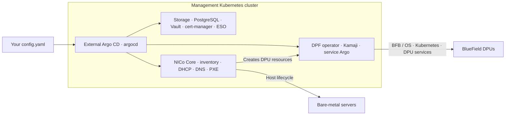

# NICo + DPF through Argo CD

**New installation plan:** [Argo-managed DPF + NVIDIA setup.sh (PDF)](user-documentation/NICo-DPF-Argo-installation-plan.pdf)
([copyable text](user-documentation/NICo-DPF-Argo-installation-plan.txt)).
This split is still being planned. The all-Argo package below is a different
ownership model; do not combine it with `setup.sh` on the same resources.

**Edit one file:** [config.yaml](config.yaml). Keep passwords outside Git.

This package stages **NICo Core 2.2.2 + DPF v26.4.0** on a clean Kubernetes
cluster. It is prepared for lab validation; a clean hardware rollout has not
been tested. This profile installs Core; REST, Flow and RMS are not included.
Do not apply it over the running standalone Europe/Asia stack.



| Standalone DPF | NICo + DPF |
| --- | --- |
| You supply DPU inventory and HBN YAML | NICo discovers/manages hardware and creates DPU resources |
| You create the BMC Secret | NICo reads the site credential from Vault and manages that Secret |
| Your tenant/HBN examples define networking | NICo owns instance/VPC networking; do not reuse Europe/Asia provisioning YAML |
| DPF prerequisites | Same DPF layer, plus PostgreSQL, Vault/PKI, ESO and NICo provisioning services |

## Step 1 — Get the files and install external Argo

```bash
git clone https://github.com/kirson-git/dsx-os.git
cd dsx-os
python3 -m venv .venv
. .venv/bin/activate
pip install PyYAML
```

Use an existing **external** Argo in `argocd`, or install it once:

```bash
helm repo add argo https://argoproj.github.io/argo-helm
helm repo update argo
helm install external-argo-cd argo/argo-cd --version 9.4.1 \
  --namespace argocd --create-namespace \
  -f NICo/values/external-argo.yaml --wait --timeout 10m
```

## Step 2 — Edit your settings

```bash
cp NICo/config.yaml "$HOME/nico-config.yaml"
vi "$HOME/nico-config.yaml"
```

Requirements: Kubernetes with three schedulable nodes for Vault, working CNI/DNS,
Helm 3, kubectl, Python 3.11+ and OpenSSL. Check node capacity and storage first.

Change the marked site names, allocated VIPs, DPU-reachable Kubernetes API IP,
controller interface, DNS/NTP servers, network pools and Unbound images.
`192.0.2.x` and `198.51.100.x` are examples, **not our lab IPs**.
Keep `enableIntegration: false` until credentials are seeded.

- Storage exists: `storage.install: false`; set its `className`.
- New lab storage: `storage.install: true`.
- Existing load balancer: `metallb.install: false`; arrange equivalent VIP routing.
- **DHCP:** relay the dedicated provisioning VLAN to `network.dhcpVIP`.
  NICo uses Kea. Do not run the old lab DHCP responder on that same scope.
- The DPU control-plane VIP is manually reserved, outside MetalLB and DHCP pools.

## Step 3 — Install operators and Vault

```bash
bash NICo/deploy.sh --config "$HOME/nico-config.yaml" --stage 1
kubectl -n argocd get applications -l dsx.nvidia.com/stack=nico
# After the operator Applications are Synced/Healthy:
bash NICo/deploy.sh --config "$HOME/nico-config.yaml" --stage 2
kubectl -n vault wait certificate --all --for=condition=Ready --timeout=300s
kubectl -n vault get pods
```

Initialize/unseal Vault when its three pods are running. Keep this recovery file!

```bash
install -d -m 700 "$HOME/nico-private"
python3 NICo/scripts/private-bootstrap.py vault-init \
  --recovery-file "$HOME/nico-private/vault-init.json"
```

## Step 4 — NICo prerequisites, registry and credentials

```bash
bash NICo/deploy.sh --config "$HOME/nico-config.yaml" --stage 3
kubectl -n argocd get application nico-prerequisites
```

Follow [the private-file commands](docs/CREDENTIALS.md) to create registry
Secrets and seed the BMC/UEFI credentials. No password goes into `config.yaml`.
Wait for `nico-prerequisites` to become Synced/Healthy.

## Step 5 — DPF and its DPU cluster

```bash
bash NICo/deploy.sh --config "$HOME/nico-config.yaml" --stage 4
kubectl -n argocd get applications -l dsx.nvidia.com/stack=nico
# After the DPF component Applications are Synced/Healthy:
bash NICo/deploy.sh --config "$HOME/nico-config.yaml" --stage 5
kubectl -n dpf-operator-system get dpuclusters
```

There are **two Argo instances**: external Argo owns platform releases;
DPF's service Argo runs in `dpf-operator-system` and deploys DPU workloads.

## Step 6 — NICo Core, then enable DPF integration

First ensure both boot-artifact images exist. The BFB build must finish:

```bash
docker buildx imagetools inspect harbor.runailabs-ps.com/nico/boot-artifacts-x86_64:v2.2.2
docker buildx imagetools inspect harbor.runailabs-ps.com/nico/boot-artifacts-aarch64:v2.2.2
bash NICo/deploy.sh --config "$HOME/nico-config.yaml" --stage 6
kubectl -n nico-system get pods
```

After Core is healthy and credentials are seeded, change
`dpf.enableIntegration: true` in your file, then:

```bash
bash NICo/deploy.sh --config "$HOME/nico-config.yaml" --stage 6
# Wait for nico-core to show Synced before restarting:
kubectl -n argocd get application nico-core
kubectl -n nico-system rollout restart deployment/nico-api
kubectl -n nico-system rollout status deployment/nico-api --timeout=300s
kubectl -n dpf-operator-system get bfbs,dpuflavors,dpudeployments,dpus
```

NICo reads DPF settings at startup. Add approved expected-machine inventory
through NICo after validating the provisioning network; see
[hardware onboarding](docs/OPERATIONS.md). Installing Core alone does not ingest
hosts or prove Internet access/isolation.

[All prerequisites and version pins](docs/ARCHITECTURE.md) ·
[Passwords](docs/CREDENTIALS.md) · [Production changes and troubleshooting](docs/OPERATIONS.md) ·
[Validation and source provenance](docs/VALIDATION.md)
