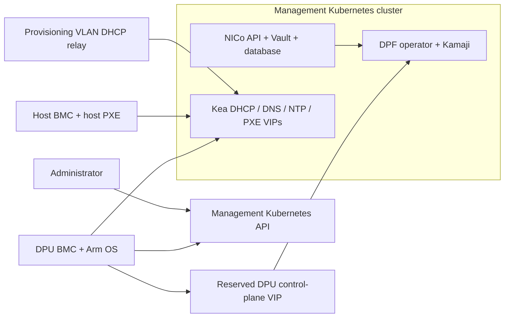

# Architecture and prerequisites

This package targets NICo Core 2.2.2 at commit
`80d131a5cd3280f9cef3131fa0c5647bdf3e79d0`, with DPF v26.4.0.
The source contracts are the pinned upstream `helm-prereqs/setup.sh`,
`helm-prereqs/helmfile.yaml`, Core chart and Rust DPF configuration.

## What each stage owns

| Stage | Application/component | Pin and purpose |
| --- | --- | --- |
| 1 | cert-manager | 1.17.1: site and workload certificates |
| 1 | PostgreSQL operator | 1.11.0: manages the NICo database cluster |
| 1 | External Secrets | 0.14.3: projects CA/database Secrets |
| 1 | Monitoring CRDs | Pinned NICo source; no Prometheus server is installed |
| 1 | MetalLB, optional | 0.14.5: exposes allocated service VIPs |
| 1 | Local-path, optional | 0.0.34: lab PVC provisioning |
| 2 | Vault TLS bootstrap | Self-signed root, site issuer, listener and Raft certificates |
| 2 | Vault | Chart 0.25.0: three Raft replicas; manual initialization/unseal |
| 3 | NICo prerequisites | PostgreSQL cluster, ESO stores, Vault PKI/auth, issuer |
| 4 | DPF service Argo | Chart 9.4.1: DPU workload delivery |
| 4 | Kamaji | 1.2.0: DPU Kubernetes control plane and datastore |
| 4 | Maintenance operator | 0.3.0: node maintenance orchestration |
| 4 | Node Feature Discovery | 0.18.3: hardware labels |
| 4 | DPF operator | v26.4.0: provisioning and DPU services |
| 5 | DPF site | OperatorConfig, `carbide-dpf-cluster`, optional LB address pool |
| 6 | NICo Core | 2.2.2: API, BMC proxy, Kea DHCP, DNS, NTP, PXE, SSH console |

External Argo chart 9.4.1 is installed separately first. It owns the shared Argo
CRDs in the management cluster. Service Argo disables CRD installation. Different
installation IDs and watched Application namespaces separate the two controllers.

## How DPF differs

Standalone DPF receives your DPU inventory, flavors, BFB and service definitions.
With NICo, NICo discovers/manages expected hardware and creates the DPF resources.
This profile disables DPF's DPU detector and sets
`installViaRedfish.skipDPUNodeDiscovery: true`. NICo owns discovery.
Do not copy standalone Europe/Asia DPUDeployment or HBN resources into this stack.

NICo's pinned prerequisite chart uses cert-manager 1.17.1, while the standalone
DPF package uses 1.19.3. This is a known upstream version skew. This package
follows NICo's pin; it does not install two cert-manager controllers. Validate
that combination on the target Kubernetes release before production adoption.

The initial profile uses the upstream BF3 provisioning path. BF4 uses
BlueFieldSoftware rather than assuming the BF3 BFB path applies. BF4 hardware
qualification and its release-specific software selection remain separate work.

## Network responsibilities

- The management cluster and BMC endpoints need stable reachable addresses.
- Relay the dedicated provisioning VLAN to the NICo DHCP VIP. The switch/router
  supplies relay configuration; installing Kubernetes resources does not do it.
- NICo manages DHCP responses from its inventory/network state. Do not run an
  independent responder for the same clients/scope.
- Service VIPs belong to MetalLB (or an existing equivalent load balancer).
- The DPU control-plane VIP belongs to keepalived. Reserve it manually outside
  DHCP allocation and outside the MetalLB pool. Its interface must exist on
  eligible control-plane nodes; VRID must be unique on that L2 domain.
- Fabric routes, VLANs, uplinks and external gateway policy are physical network
  prerequisites. Installing NICo does not automatically configure the switches.

## Extensions not installed by this profile

| Extension | Additional integration work |
| --- | --- |
| REST multi-site API | REST charts/images, identity provider, Temporal with mTLS, REST database and site registration |
| Flow | Flow chart/image, database, certificates and workflow configuration |
| RMS/component manager | Rack-manager chart/images, database, certificates and rack inventory |
| Observability | Prometheus/Grafana/log/trace backends and retention settings |

These are deliberate exclusions from the Core 2.2.2 profile, not toggles that can
be safely enabled without their prerequisites. Follow the pinned upstream setup
phases when adding them and give each resource one Argo owner.
