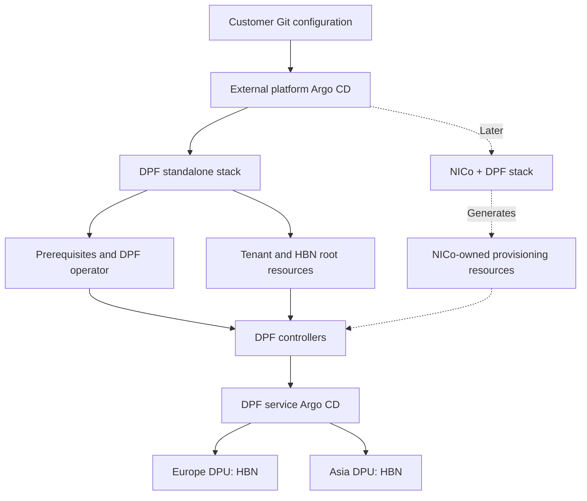

# DSX OS deployment examples

Deploy **standalone DPF** first; add **NICo + DPF** through a separate stack later.
Both paths use an external platform Argo CD, distinct from DPF's service Argo CD.

| Directory | Purpose | Delivery state |
| --- | --- | --- |
| [DPF](DPF/README.md) | Prerequisites, DPF operator and a two-tenant HBN example | Renderable package; clean rebuild qualification pending |
| [NICo](NICo/README.md) | NICo integrated with a compatible DPF release | Planned; not installable yet |



## Step 1: install external Argo CD

Start with a working Kubernetes cluster, Helm and kubectl configured for that
cluster. For a clean cluster, run these commands from any directory:

```bash
helm repo add argo https://argoproj.github.io/argo-helm
helm repo update argo
helm install external-argo-cd argo/argo-cd \
  --version 9.4.1 \
  --namespace argocd --create-namespace \
  --set configs.cm.installationID=dsx-platform \
  --wait --timeout 10m
```

This installs external Argo CD and its CRDs. Version 9.4.1 is the chart pinned
by this package. The installation ID distinguishes this controller from DPF's
service Argo CD. See the [official chart repository](https://argoproj.github.io/argo-helm/).

Check the installation:

```bash
helm status external-argo-cd -n argocd
kubectl get pods -n argocd
```

## Step 2: configure and deploy DPF

Follow the [DPF guide](DPF/README.md) in order. For the one-YAML option,
[prepare the namespace, site settings and password first](DPF/INSTALLATION-DETAILS.md#2-set-the-dpu-bmc-ip-and-create-the-password-secret).
This public repository uses HTTPS, so Argo needs no
Git credentials. For a private fork, configure
[private Git access](DPF/CREDENTIALS.md).

| Option | Files | Behavior |
| --- | --- | --- |
| One YAML | [DPF/install.yaml](DPF/install.yaml) | Automatically syncs the complete stack, including DPU provisioning |
| Step by step | [DPF/generated/applications/](DPF/generated/applications/) | Apply and manually sync each of the five stages in order |

**Choose one option per installation.** Both manage the same resources, so do
not apply both. Provisioning can reimage DPUs once real hardware is configured.

See the [one-YAML command](DPF/INSTALLATION-DETAILS.md#option-a-one-yaml-for-the-complete-stack)
or the [step-by-step commands](DPF/INSTALLATION-DETAILS.md#option-b-separate-yamls-for-control-of-each-stage).
No custom installation wrapper is required.

Start with the [DPF installation guide](DPF/README.md), then review
[production changes](DPF/PRODUCTION.md) and the
[two-tenant example](DPF/profiles/two-tenant-hbn/README.md).

The example uses illustrative addresses and hardware identities. Credentials,
private keys, kubeconfigs and raw lab backups are excluded. Supply authentication
privately using your secret-management process.

This is a project-authored GitOps adaptation, not an NVIDIA-supported installer
or a production qualification. See [source provenance](DPF/SOURCES.txt).

## What is included in Git

The DPF entry YAML, five stage Applications, rendered platform manifests,
tenant/HBN/provisioning examples, Bash credential helper, pinned prerequisite
charts, renderer, tests and guides are tracked in this repository.

Passwords, private keys, kubeconfigs, runtime Secrets and recovery backups stay
outside Git. Container images and BFB downloads are external artifacts referenced
by the manifests; they are not bundled in this repository.

## Storage choice

| Install storage | Setting in `DPF/site.yaml` |
| --- | --- |
| Enabled: install a provisioner for a fresh lab | `storage.installLocalPath: true` |
| Disabled: reuse healthy existing storage | `storage.installLocalPath: false` |

[Apply your choice](DPF/README.md#2-choose-storage) by regenerating and pushing
manifests before syncing. Argo does not auto-detect an existing provisioner.

For LLM assistants, load the [DPF Argo skill](.agents/skills/dsx-dpf-argo/SKILL.md).
