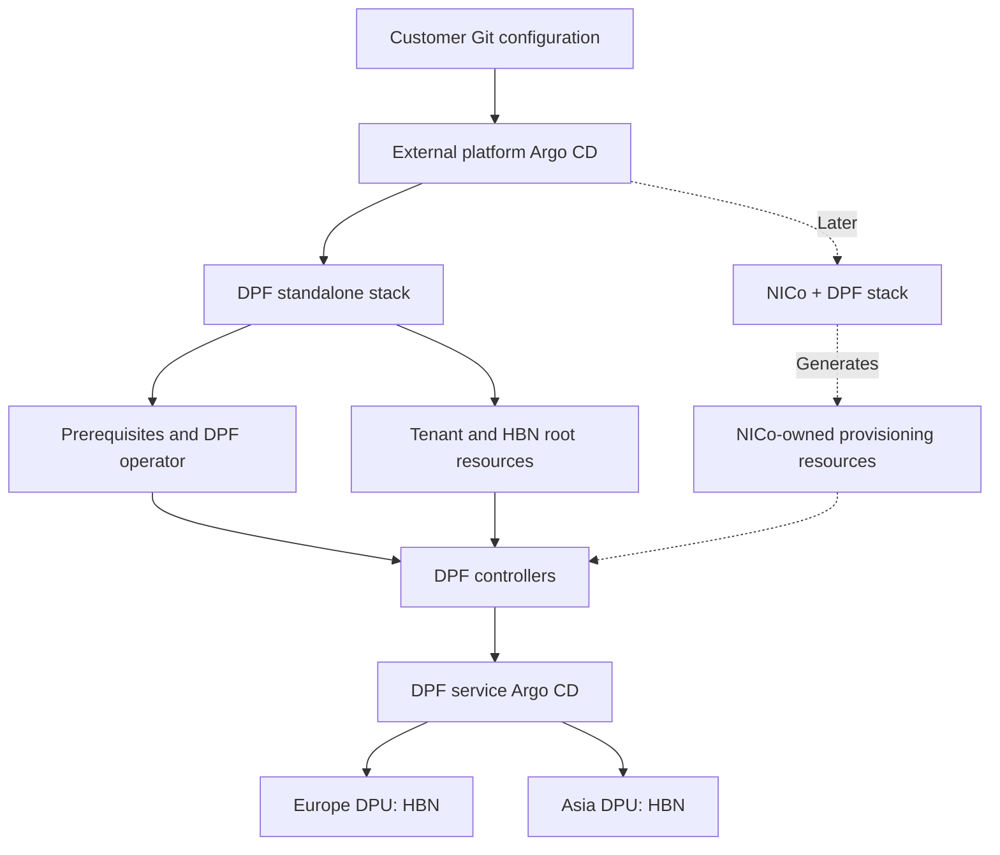

# DSX OS deployment examples

Deploy **standalone DPF** first; add **NICo + DPF** through a separate stack later.
Both paths use an external platform Argo CD, distinct from DPF's service Argo CD.

| Directory | Purpose | Delivery state |
| --- | --- | --- |
| [DPF](DPF/README.md) | Prerequisites, DPF operator and a two-tenant HBN example | Renderable package; clean rebuild qualification pending |
| [NICo](NICo/README.md) | NICo integrated with a compatible DPF release | Planned; not installable yet |

## Choose how to install DPF

First install external Argo with the Helm command in the
[DPF guide](DPF/README.md#1-install-external-argo-with-helm), configure your site,
and create the private BMC password Secret with `bash DPF/credentials.sh`.

| Option | Files | Behavior |
| --- | --- | --- |
| One YAML | [DPF/install.yaml](DPF/install.yaml) | Automatically syncs the complete stack, including DPU provisioning |
| Step by step | [DPF/generated/applications/](DPF/generated/applications/) | Apply and manually sync each of the five stages in order |

**Choose one option per installation.** Both manage the same resources, so do
not apply both. Provisioning can reimage DPUs once real hardware is configured.

See the [one-YAML command](DPF/README.md#option-a-one-yaml-for-the-complete-stack)
or the [step-by-step commands](DPF/README.md#option-b-separate-yamls-for-control-of-each-stage).
No custom installation wrapper is required.

Start with the [DPF installation guide](DPF/README.md), then review
[production changes](DPF/PRODUCTION.md) and the
[two-tenant example](DPF/profiles/two-tenant-hbn/README.md).

The example uses illustrative addresses and hardware identities. Credentials,
private keys, kubeconfigs and raw lab backups are excluded. Supply authentication
privately using your secret-management process.

This is a project-authored GitOps adaptation, not an NVIDIA-supported installer
or a production qualification. See [source provenance](DPF/SOURCES.txt).

## What is included in Git

The DPF entry YAML, five stage Applications, rendered platform manifests,
tenant/HBN/provisioning examples, Bash credential helper, pinned prerequisite
charts, renderer, tests and guides are tracked in this repository.

Passwords, private keys, kubeconfigs, runtime Secrets and recovery backups stay
outside Git. Container images and BFB downloads are external artifacts referenced
by the manifests; they are not bundled in this repository.
