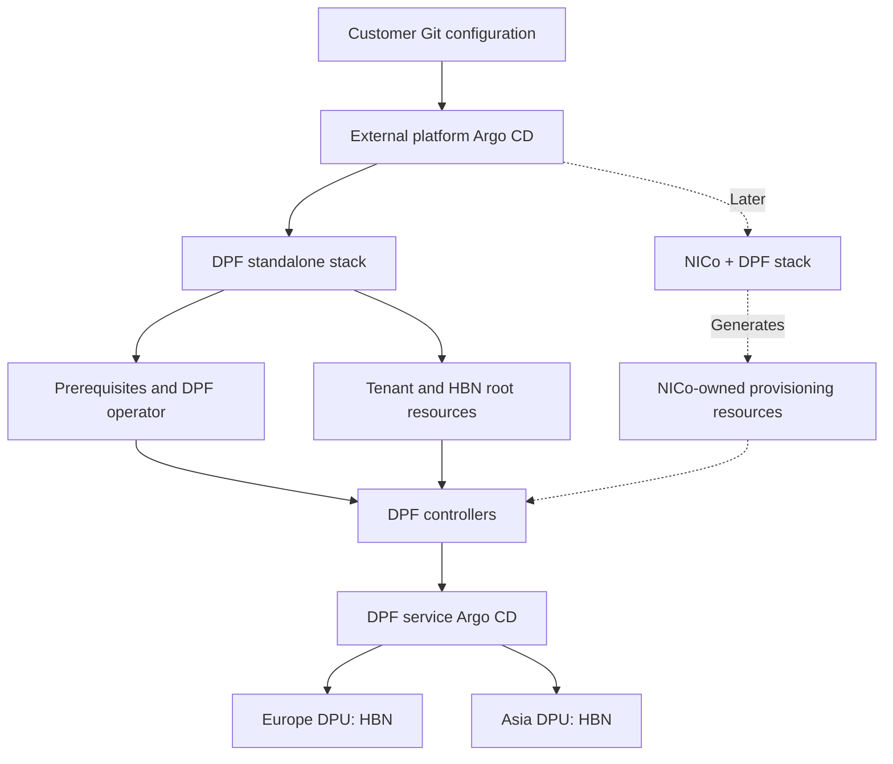

# DSX OS deployment examples

Deploy **standalone DPF** first; add **NICo + DPF** through a separate stack later.
Both paths use an external platform Argo CD, distinct from DPF's service Argo CD.

| Directory | Purpose | Delivery state |
| --- | --- | --- |
| [DPF](DPF/README.md) | Prerequisites, DPF operator and a two-tenant HBN example | Renderable package; clean rebuild qualification pending |
| [NICo](NICo/README.md) | NICo integrated with a compatible DPF release | Planned; not installable yet |

Install external Argo with standard Helm, then apply the DPF Application YAMLs.
No custom installation wrapper is required.

Start with the [DPF installation guide](DPF/README.md), then review
[production changes](DPF/PRODUCTION.md) and the
[two-tenant example](DPF/profiles/two-tenant-hbn/README.md).

The example uses illustrative addresses and hardware identities. Credentials,
private keys, kubeconfigs and raw lab backups are excluded. Supply authentication
privately using your secret-management process.

This is a project-authored GitOps adaptation, not an NVIDIA-supported installer
or a production qualification. See [source provenance](DPF/SOURCES.txt).
